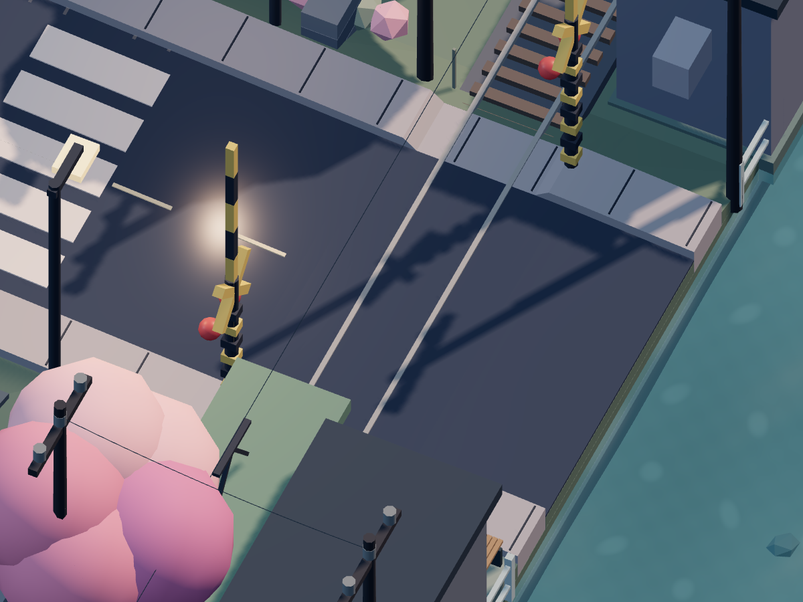
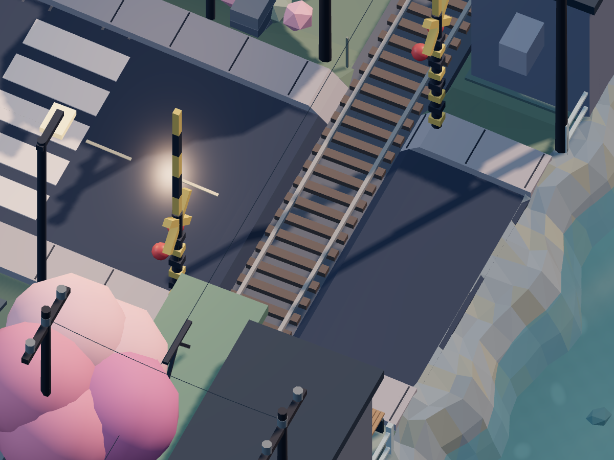
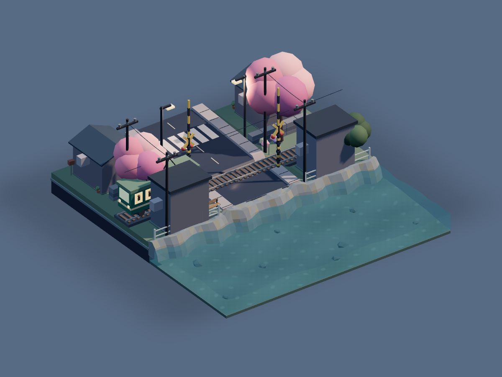
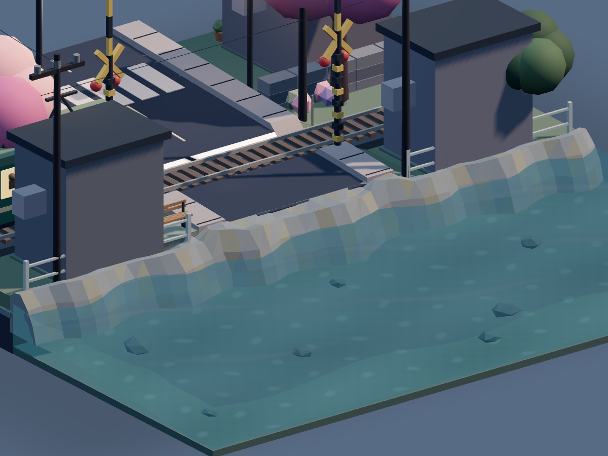
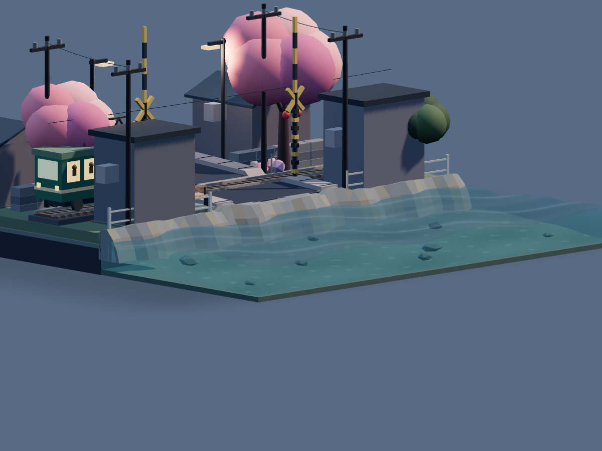

# 最终局部修复：完整轨道与弯曲礁石岸线

基于 `8b7b39a`，本轮应用源码只涉及 `CoastalGround.ts`、`SceneB.ts` 和新增的 `RockyCoast.ts`。海洋算法、控件、天气、昼夜、电车/道口状态机、相机、UI 和便利店源码保持原版。

## 完整“钢轨＋横向枕木”恢复

两根钢轨及 48 根枕木一直完整生成。问题是旧道口路面高度为 .55，高于原枕木顶部 .505，因此道路中央只能看见部分轨头，整根枕木被遮住。按用户最新旧图要求，保留整套轨道原网格、高度、材质、间距和尺寸，降低局部遮挡面，恢复与两侧相同的露枕外观。

| 部件           | 最终尺寸 / 高度                                                 | 处理                        |
| -------------- | --------------------------------------------------------------- | --------------------------- |
| 钢轨           | 两根沿 x 方向连续 14 单位，轨顶 .57、底部 .49                   | 原样保留                    |
| 横向枕木       | 48 根，`.13 × .09 × 1`，x 间距 .29，y=.415–.505，原色 `#5f5b5c` | 原样保留                    |
| 原轨道底座     | 顶部 .42                                                        | 继续支撑枕木，底部嵌入 5 mm |
| 道口铺面       | `                                                               | z                           | ≤.5` 内降为 .40，低于整根枕木底部 | 路面及其实体填土同步改变 |
| 接近道口的路面 | `                                                               | z                           | =.5–.65` 与原高度连接             | 两个采样断面保持闭合过渡 |
| 信号柱支撑     | z=±.85 的人行道高度                                             | 原样保留                    |

钢轨仍位于枕木上方，电车轮底与轨顶关系不变。没有整体抬高铁路；人行道与路基仍为闭合实体，局部最低厚度约 .16，基础继续与原地基相接。

浏览器对实际场景模型检查了全部 48 根枕木的位置/间距/材质，以及道口中央每根枕木的多个横向点：上方射线首先命中枕木，不再命中道路。两条轨顶亦连续可见，保持 .57 高度。

### 道口对照

修复前：

修复后，原枕木与钢轨贯穿道路中央：

与用户旧图对应的低斜角：[恢复后](after-legacy.png)。

其他角度：[俯视前](before-top.png) / [俯视后](after-top.png)、[斜视前](before-oblique.png) / [斜视后](after-oblique.png)、[道路出现强高光时](after-glare.png)。

## 连续弯曲礁石岸线

原生 CatmullRomCurve3 定义不规则岸线，45 个截面、每截面 7 点连接成一整条闭合 BufferGeometry，共 626 个三角面。顶部、露水肩部、水下斜面与埋入海床的底缘具有宽窄和高低变化；灰蓝/暖灰顶点色与切面法线保持现有微缩风格。

岸带与原陆地在 z=-2.32 处相接，底缘嵌入现有海床；局部外缘最远约 z=-3.7，保留海域中心及大部分可见水面。材质为不透明岩石，沿用原透明水体的正常深度测试，不增加透明叠层。海床、侧壁和波浪计算未修改。鼠标只在实际被岩石遮住的位置停止注入，开放水域继续可交互。

调研及许可证见 [RESEARCH.md](RESEARCH.md)。未引入依赖或外部资产。

## 检查与实际文件

- `npm test`：31 项通过，覆盖完整轨道的露出高度、原支撑面、人行道/路基实体、礁石闭合边界、正体积、低面数、海床接地，以及原海洋和道口测试。
- `npm run build`：通过 TypeScript 和 Vite，保留原 Three.js 包体积提示。
- 固定截图使用实际 SceneManager、场景构造器和原 Environment 光照，只在测试夹具内固定视角与帧以便比较；产品相机没有改动。
- 浏览器专项与原有交互回归共 4 项全部通过：实际 48 根枕木和两条轨头的无遮挡检查、八个固定视角、正式海面悬停/动态波浪、夜晚、资源回收、电车/栏杆完整周期和连续点击锁定，以及触摸旋转/双指缩放。日志见 [browser-tests.txt](browser-tests.txt)。
- 海面测试记录了 36 次鼠标扰动注入，停止移动后不再注入，波浪相位继续推进；控制台和 Shader 错误均为 0。[正式场景运行录屏](dynamic-coast.webm)。
- 五轮 A/B 切换前后均为 257 个几何资源 / 11 张纹理；中雨完整视角 Draw calls 为 260。相较原版只增加一个礁石 Mesh / 几何与一次绘制，没有新增纹理或模拟渲染通道。
- 移动端为 Chromium 触屏模拟，本轮没有真实 iPad / Safari 硬件测试。软件渲染录屏不作为设备帧率基准。
- 最终 `dist` 经本地生产预览实际加载：海面记录 34 次鼠标注入、十一项海洋控件及场景切换正常，控制台/Shader 错误为 0。记录见 [production-smoke.json](production-smoke.json)。

| 文件                                 | 实际改动                                                                   |
| ------------------------------------ | -------------------------------------------------------------------------- |
| `src/scenes/CoastalGround.ts`        | 降低遮挡枕木的局部路面，增加两个过渡采样断面；关联实心路基与步行面同步适配 |
| `src/scenes/SceneB.ts`               | 只增加礁石模块的 import 与加入场景两行                                     |
| `src/scenes/RockyCoast.ts`           | 曲线岸线、连续封闭低多边形岩体、顶点色和海床接地                           |
| `tests/structures.test.ts`           | 依据露枕要求更新高度检查，继续检查实体基础                                 |
| `tests/final-polish.test.ts`         | 局部路面、礁石闭合拓扑/接地/开放水域验证                                   |
| `tests/browser/final-polish.spec.ts` | 实际轨道与枕木、八个固定视角、正式场景水波/悬停/资源回收                   |
| `README.md`                          | 最终修复报告入口                                                           |
| `docs/final-polish/*`                | 对比图、运行录屏、调研与本报告                                             |

本轮结束后只进行最终验收，不追加新功能。
