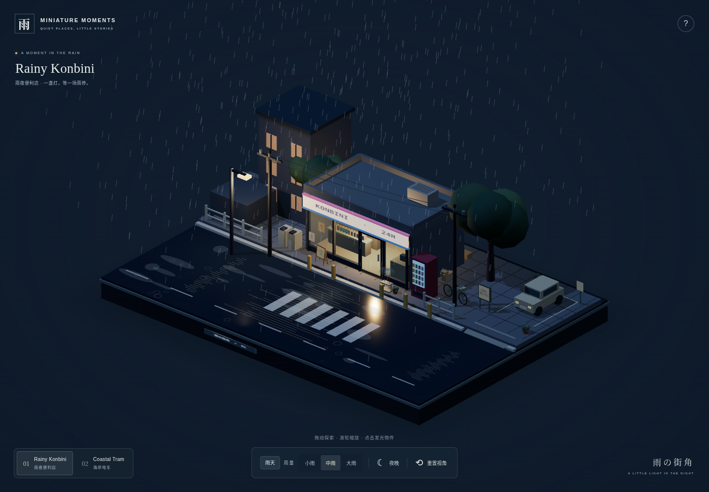
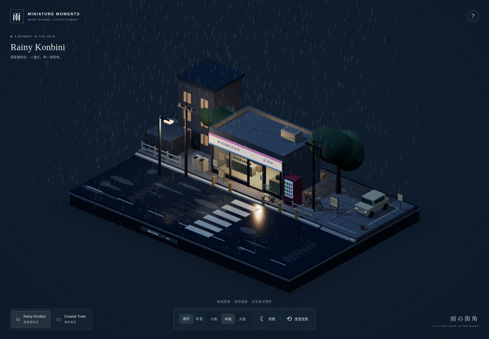
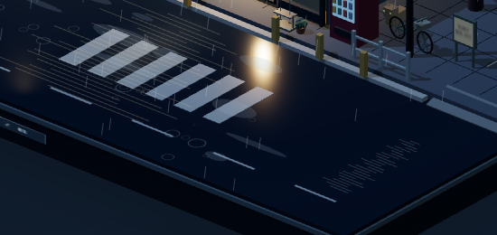
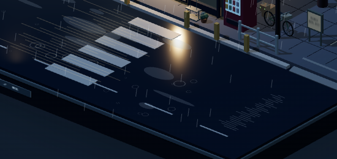
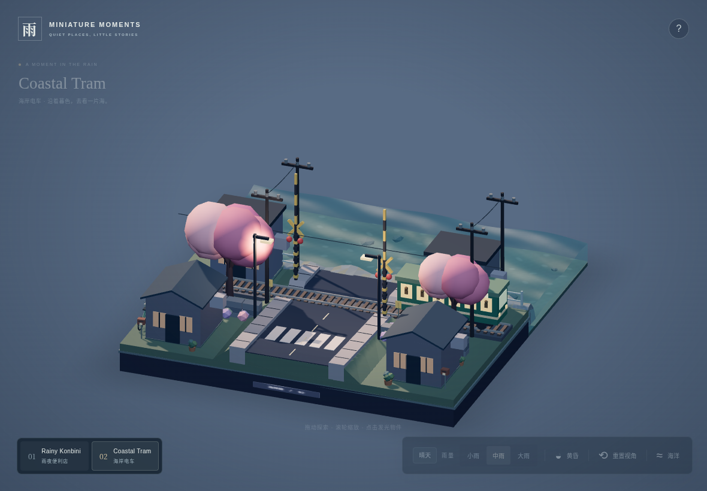
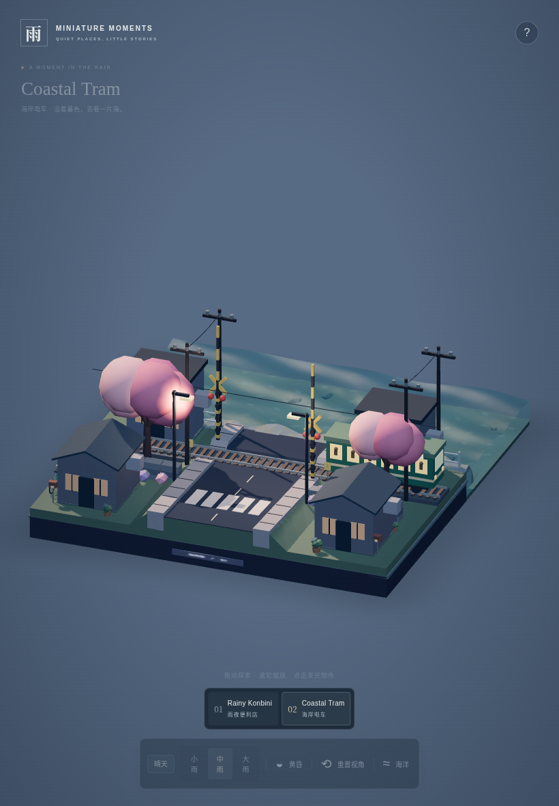

# Miniature Moments — Final Two Fixes

本轮仅调整便利店斑马线几何与现有海洋的触屏输入协调。

## 斑马线

便利店道路沿 X 轴延伸，行人从店前人行道沿 Z 轴过街。将整组标线围绕原中心 `(2.225, 0.055, 2.8)` 旋转 90°：条纹长边沿道路，六条标线沿过街方向排列。原有 `0.5 × 0.012 × 1.9` 几何尺寸、`0.85` 中心间距、`#b8c2c8` 颜色及高度保持不变。

标线范围为 X `[1.275, 3.175]`、Z `[0.425, 5.175]`，位于现有道路内。没有调整道路或其他物件。

| 原视角：修复前                            | 原视角：修复后                           |
| ----------------------------------------- | ---------------------------------------- |
|            |            |
|  |  |

## 平板输入

在现有 `OceanInteraction` 内使用 Pointer Events 的捕获阶段协调触摸，沿用原有 Raycaster、水面局部坐标、遮挡检测、`RippleStroke` 与 `water.inject`，没有增加模拟系统。

新增触摸处理仅在当前场景存在海洋时启用；便利店继续使用原有触屏操作。

- 首指落在未被物体遮挡的水面：锁定为 `water`，捕获该指针，阻止事件进入相机及物件点击监听器；清除前一次相机拖动的残余惯性，同时保留当前视角。
- 单指移动：复用桌面的扰动路径与速度计算。静止不注入；移出水面清除轨迹锚点，镜头不会接管。
- 首指从非水面开始：整次手势归 `camera`，即使滑入水面也不划水。
- 第二指加入：停止水波输入，向 OrbitControls 补交首指的当前位置，再让真实第二指事件继续进入原有双指处理。剩下一指时仍归相机，所有触点结束后才重新判断归属。
- 抬指、取消、丢失捕获、窗口失焦、场景切换和销毁均清理输入；现有水波继续传播衰减。保留原有 `touch-action: none`，不新增网页滚动或样式修改。

浏览器触屏模拟截图见下方；截图是操作后的浏览器渲染，没有添加产品界面元素或手指标记。

| 横屏模拟                         | 竖屏模拟                         |
| -------------------------------- | -------------------------------- |
|  |  |

## 修改文件

功能源码：

- `src/scenes/SceneA.ts`：仅修改斑马线生成循环。
- `src/ocean/OceanInteraction.ts`：触屏归属、捕获与清理、双指移交；鼠标与触摸共用原有水面命中及扰动接口。

验证与说明：

- `tests/browser/final-two-fixes.spec.ts`：斑马线几何与截图、横竖屏原生触摸事件回归。
- `tests/browser/ocean-interactive.spec.ts`：仅将原先“触屏不注入”的测试名称改为准确的“静止轻点不注入”，断言保持原样。
- `README.md`：更新触屏操作说明并链接本报告。
- `docs/final-two-fixes/REPORT.md`：本报告。
- `docs/final-two-fixes/crosswalk-before.png`、`crosswalk-before-close.png`、`crosswalk-after.png`、`crosswalk-after-close.png`、`tablet-1180x820.png`、`tablet-820x1180.png`：本轮验证截图。

海洋 Shader、波浪模拟、Ocean Controls、海床、礁石、铁路、电车、道口、天气、昼夜、相机参数与 UI 样式均未修改。

## 验证

触屏检查使用 Chromium 的 CDP `Input.dispatchTouchEvent`，由浏览器生成触摸 Pointer Events 和实际指针捕获；不是仅向应用发送脚本伪造的滑动事件。双指接管时补交首指的事件属于实现所需的合成事件，后续移动来自浏览器触摸输入。

横屏 `1180×820` 与竖屏 `820×1180` 均通过：单指划水、静止不注入、划出水面不旋转、非水面开始后归属不变、相机惯性期间开始划水后镜头稳定、水面手势转双指缩放、抬起一指仍归相机、取消/失焦/场景切换清理及恢复交互、禁止页面滚动。

| 触屏尺寸 | 划水注入计数 | 停止注入时能量 | 约两秒模拟时间后能量 | 后续计数 |
| -------- | -----------: | -------------: | -------------------: | -------: |
| 1180×820 |           15 |     0.00068255 |           0.00003879 |       15 |
| 820×1180 |           24 |     0.00184596 |           0.00012973 |       24 |

计数不再增加而波场继续演化，能量分别衰减约 94% 与 93%。这些数值是本次操作轨迹对应的诊断数据，不是对真实设备帧率的测量。

`npm test`：31/31 通过。`npm run build`：TypeScript 检查与 Vite 生产构建成功；仍有原先 Three.js 公共包超过 500 kB 的提示，没有新增构建错误。

浏览器回归 8/8 通过：

```bash
npx playwright test tests/browser/final-two-fixes.spec.ts tests/browser/ocean-interactive.spec.ts tests/browser/worlds.spec.ts --reporter=line
```

覆盖新修复、桌面鼠标划水/拖动旋转/滚轮缩放/停止后衰减、十一参数与减少运动、原有便利店物件点击、道口完整动画、移动端物件轻触/旋转/缩放、场景切换和资源释放。浏览器没有捕获到控制台错误或未处理异常；连续切换前后均为 257 个几何、11 个纹理。

最终生产包也通过本地 `vite preview` 浏览器检查：便利店触摸点击与旋转保持原样；海岸单指划水、静止停止注入、双指接管和非水面旋转正常；桌面悬停划水、拖动及滚轮缩放正常。触屏和桌面分别产生 28、32 次注入，手势结束后的归属清空，控制台错误为 0。

在线预览：<https://jiyannli.github.io/miniature-moments/>。发布沿用已有 GitHub Pages 工作流。

**未完成真实 iPad / Safari 硬件验证。** 软件 WebGL 环境的结果用于验证功能与事件协调，不代表真实设备帧率。
