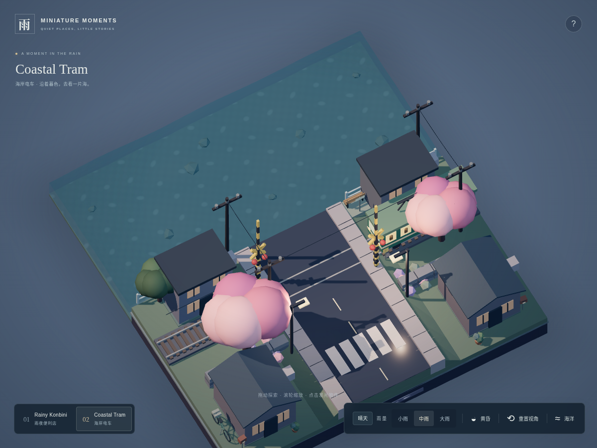
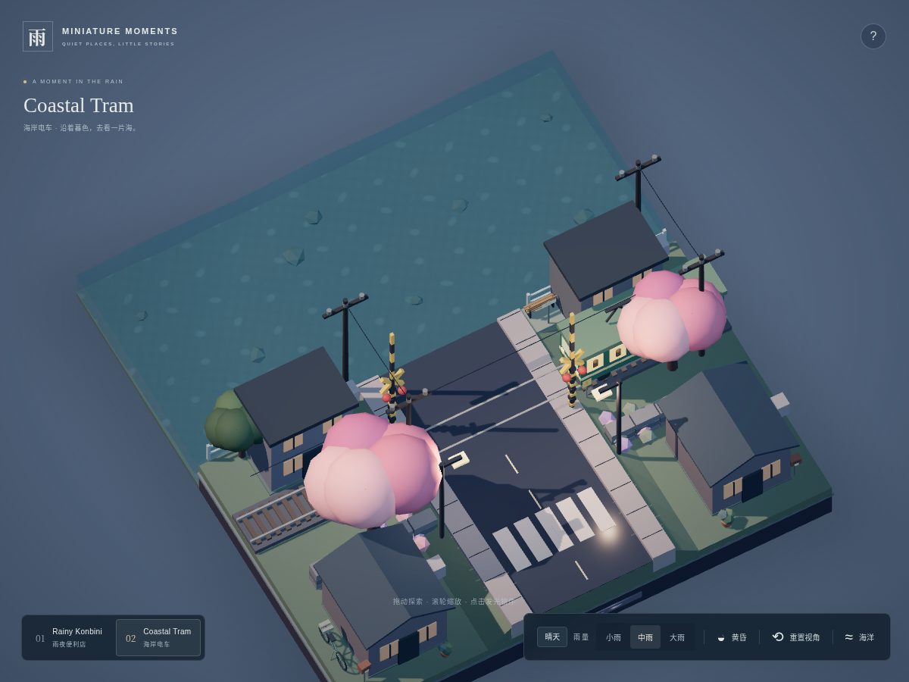

# 道口中段铁轨遮挡修复

## 根因和改动范围

两根铁轨模型原本连续贯穿道口，但轨头高度为 .57，人行道过轨处仍沿用路面上方 .13 的路缘高度（顶面 .68），因此从上方看像缺失了两段铁轨。

只修改 `src/scenes/CoastalGround.ts` 的 `coastSidewalkHeight`：轨道走廊 `|z|≤.65` 的步行面降至道口路面 .55，让轨头露出 .02；在 `.65<|z|<.8` 恢复路缘高度。复用原有采样断面和实体路基，不增加覆盖铁轨的贴片，也不整体抬高轨道。

`|z|≥.8` 的人行道高度保持原值，包括信号柱 `z=±.85` 的支撑面。电车、轨道模型、道口状态机、相机、海洋、便利店和 UI 源码均未修改。

## 防止回归

`tests/structures.test.ts` 增加实际三角面 Raycaster 检查：沿两根轨头的整个道口跨度及轨宽采样，确认路面、人行道和边坡都低于轨头；检查信号柱处的人行道高度和过渡坡面。旧代码会在 `supported-sidewalk` 遮挡轨头处失败，修复后通过。

- `npm test`：22 项通过。
- `npm run build`：通过；保留原有 Three.js 包体积提示。
- 浏览器截图：同样的旋转和缩放操作下，道口两侧步行面上的缺口恢复连接，控制台无新增错误。
- `npm run test:browser -- tests/browser/worlds.spec.ts`：2 项通过，验证电车及道口全周期、重复点击锁定、便利店交互、场景切换、天气/昼夜、相机、触摸旋转/缩放和资源回收。五轮切换前后海岸仍为 256 几何 / 10 纹理，Draw calls 259。

## 实际浏览器对照

修复前：

修复后：

