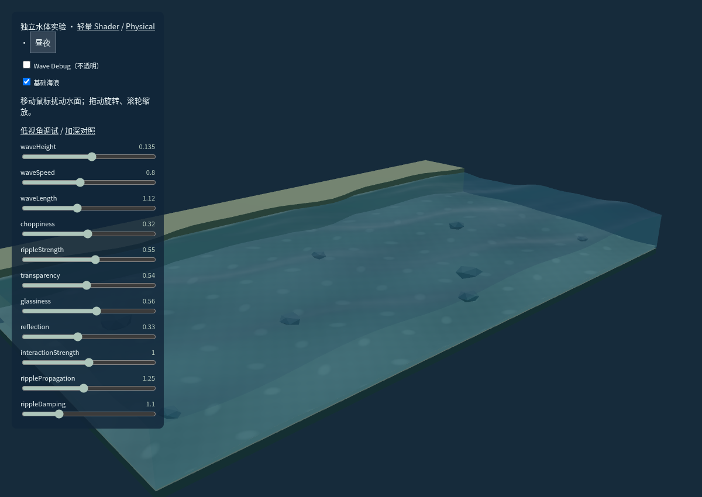
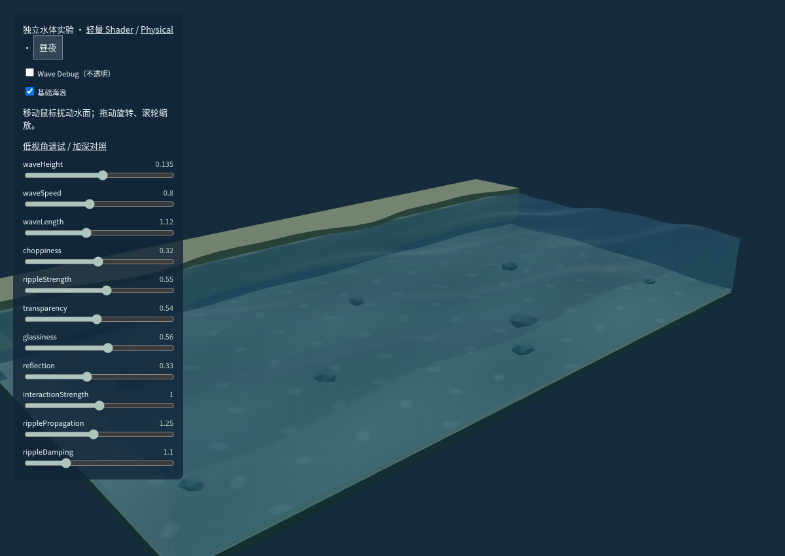
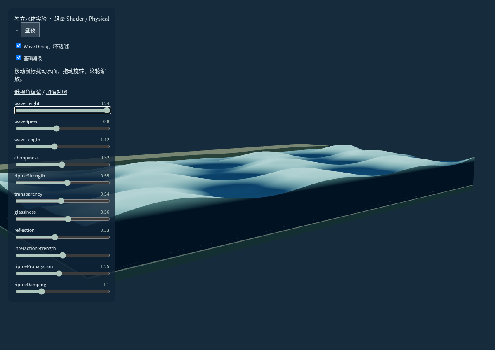
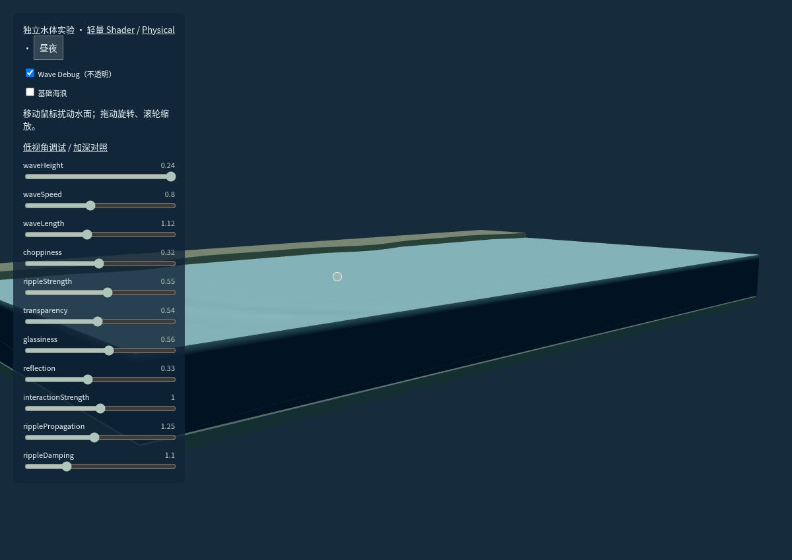
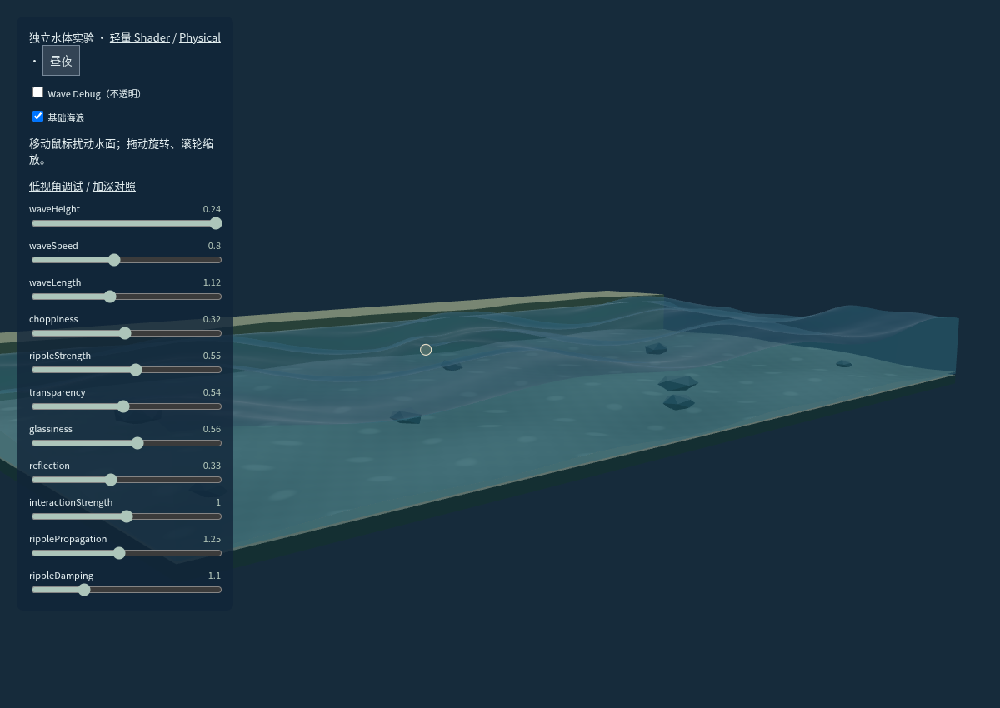

# Coastal Tram：交互式动态海洋

## 本轮范围和诊断

在铁轨修复 `2240e4f` 上增量开发。原海面已有三组 Gerstner 位移和有效的八参数传递，但默认波幅小、表面层次弱、细涟漪只有法线变化，没有鼠标扰动状态，因此视觉上偏平。诊断、预算和实现顺序先记录于 [DESIGN.md](DESIGN.md)，参考许可与兼容性核查见 [RESEARCH.md](RESEARCH.md)。

没有迁移渲染架构或增加运行依赖。Rainy Konbini、道口状态机、道路/轨道模型和相机控制器未修改。正式场景 `SceneB.ts` 仅增加水体接口与销毁回调，`main.ts` 和 World 类型负责接入海洋输入。网页只调整海洋面板的最大高度，为十一项控制保留顶部空间；原布局和铁轨修复保留。

## 阶段交付与文件

| 阶段         | 结果                                                                         | 文件                                                                                                                       |
| ------------ | ---------------------------------------------------------------------------- | -------------------------------------------------------------------------------------------------------------------------- |
| 1 技术审查   | 核实真实位移、网格、时间、参数、透明层和缺失的输入状态                       | `DESIGN.md`                                                                                                                |
| 2 案例研究   | 检查指定海洋案例、Three r180 GPGPU 水例；GitHub 搜索补充高度场案例并核实许可 | `RESEARCH.md`                                                                                                              |
| 3 独立原型   | 不规则实体岸线、沙床/岩石、基础波、交互高度场、低视角不透明调试和控制面板    | `src/lab/water-lab.ts`、`water-lab.html`                                                                                   |
| 4 水体视觉   | 三组更清晰的几何波浪、总位移法线、天空 Fresnel/吸收近似、沙脊/深浅变化、剖面 | `src/ocean/Gerstner.ts`、`src/water/OceanShaders.ts`、`OceanWater.ts`、`Seabed.ts`                                         |
| 5 控制与输入 | 十一项控制、鼠标速度/轨迹插值、静止过滤、拖动与缩放隔离                      | `src/ocean/OceanController.ts`、`RippleField.ts`、`RippleStroke.ts`、`OceanInteraction.ts`、`src/ui/OceanPanel.ts`         |
| 6 正式整合   | 共用控制状态、场景切换时解绑水体并释放专属纹理，既有交互不截断               | `src/main.ts`、`src/core/types.ts`、`src/scenes/SceneB.ts`                                                                 |
| 7 动态验收   | 数值安全、传播/阻尼、输入、资源回收、实体支撑、实际 WebGL 截图与录屏         | `tests/ripples.test.ts`、`ocean.test.ts`、`water.test.ts`、`structures.test.ts`、`tests/browser/ocean-interactive.spec.ts` |

## 波动模型与实际几何

基础波继续采用三方向 Gerstner，在 GPU 同时计算水平和垂直位移。提高可见振幅及相速；水平陡度独立限制，防止高波幅/短波长组合折叠。桌面水面 128×64 分段，触屏 96×48；剖面顶边采用相同分段与同一位移函数。

交互高度场为桌面 96×48 / 触屏 64×32，固定 1/120 秒步长的二维阻尼波动方程。以世界单位计算不同横纵格距的拉普拉斯。局部注入一个峰和周边谷，已有波继续传播、干涉与衰减；边界固定并有吸收带。

评估了 GPU ping-pong / GPUComputationRenderer 后，选择当前规模更直接的 CPU TypedArray 求解 + GPU 纹理采样。每次活动更新上传单通道浮点纹理，Shader 手动双线性采样，既不要求浮点颜色附件，也不要求浮点线性过滤扩展。没有每帧 GPU 读回或额外模拟渲染 pass。

最终顶点高度等于基础海浪加交互高度场；法线由总位移差分得到。交互波不是颜色贴图。高度场最多 ±.16；基础振幅最多 .24；岸边衰减、边缘固定和垂直余量保证不淹没岸边、不穿海床。水面与侧壁引用相同位移，交互高度在外边界为零。

## 输入规则

普通鼠标移动通过 Raycaster 的水面局部参考平面求交，并检查实际 Mesh 遮挡。架空线不会因默认的宽射线拾取半径而误挡整个水域。基于世界空间速度计算强度，沿轨迹最多 64 点插值，限制峰值；小于 .035 场景单位的抖动不激发。

每帧只处理最新鼠标样本，允许慢设备较长的帧间隔。按下、拖动、滚轮、镜头惯性、离开水域、失焦和场景切换清除输入锚点，停止新注入；已经产生的水波继续求解。触屏保留单指旋转和双指缩放，不以触摸拖动扰动水面。减少动态效果模式冻结环境水波。

## 参数与天气

原面板默认折叠、仅在海岸显示；增加三项交互参数，窄屏仍在原面板内滚动。没有新增独立交互模式。

| 参数                 | 范围    | 明确作用                         |
| -------------------- | ------- | -------------------------------- |
| Wave Height          | .02–.24 | 几何峰谷幅度                     |
| Wave Speed           | .2–1.6  | 基础海浪相速倍率，积分相位不跳变 |
| Wave Length          | .65–1.8 | 基础波长倍率                     |
| Choppiness           | 0–.65   | 安全限幅的水平位移               |
| Ripple Strength      | 0–1     | 天气细涟漪法线扰动，独立于鼠标波 |
| Transparency         | .25–.85 | 通透度及吸收权重                 |
| Glassiness           | 0–1     | 高光宽度                         |
| Reflection           | 0–.8    | 环境色反射及高光强度             |
| Interaction Strength | 0–2     | 鼠标局部扰动，0 时停止新注入     |
| Ripple Propagation   | .45–2.2 | 波动方程传播速度（场景单位/秒）  |
| Ripple Damping       | .25–3.5 | 衰减速率，大值更快恢复平静       |

Calm / Breeze / Windy 的基础振幅为 .055 / .135 / .205，默认 Breeze。预设、模式、参数继续平滑转换。Auto 的天气影响细涟漪、光泽与通透；降雨不直接改变风浪预设。Manual 不被天气覆盖，夜晚仍影响外观。交互状态与基础海浪分别求解。

## 水体、海床与厚度选择

比较了实验页默认底部 -.78 与加深至 -1.13 的剖面。加深对照增加水体厚度，但与现有陆地底座的比例不如原厚度协调。因此正式场景保留海面 .12 / 底部 -.78，不抬高建筑、道路、铁轨或陆地底座。改用有局部沙脊和深浅变化的海床，8 块岩石按新地形重新接地，改善水下层次。

水面高光随总法线和视角变化，透明度区间反馈更清楚；保留深度测试、FrontSide 外侧壁、不写透明深度和开放岸侧，避免重新引入共面闪烁。Fresnel、吸收与焦散均为近似，没有实时建筑倒影、物理折射、SSR 或 FFT。

## 铁轨与步行面的现实关系

继续检查两根轨头跨越路面/人行道的可见性，保持轨头 .57、步行过轨面 .55。过渡在 |z|=.65–.8 回到正常路缘，信号柱仍在 |z|=.85 的原支撑面。增加从上、下两向射线检查：过轨平段和缓坡的底面均为 .24，与已有 .25 地基相接，不是浮空薄片。

闭合路基、边坡、轨道、电车轮高和栏杆扫掠保持原逻辑；不通过抬高整个铁轨掩盖路面遮挡。[铁轨修复对照](../fixes/coastal-rail-crossing.md)。

## 动态证据

以下均为实际 Chromium WebGL 输出。

波高参数实际对照：[最小波高](wave-height-min.png) / [最大波高](wave-height-max.png)。[最终生产包中的控制面板](production-panel.png)。

[独立水体动态录像](interactive-ocean.webm)展示真实基础起伏、关闭基础波后的鼠标峰谷、停止后的衰减，以及半透明、角度、缩放和夜晚变化。[正式海岸交互录像](coast-interaction.webm)展示实际场景中的鼠标扰动、拖动/缩放隔离、控件和场景切换。

手机面板：[截图](panel-phone.png)。不透明调试入口为 `water-lab.html?debug=1&low=1`；可取消“基础海浪”单独观察交互高度场。加深对照为 `water-lab.html?bed=deep`，原物理材质对照继续为 `?mode=physical`。

## 验证与性能记录

独立求解器测试验证传播到原本平静区域、停止注入后衰减、不同传播/阻尼参数、固定步长的帧间隔一致性、连续极值扰动有界和边界为零。水体测试覆盖总高度、海床余量、顶面/侧壁接缝及纹理销毁去重。实体步行面支撑检查通过。

本环境 Node.js 活动高度场计时见 [solver-cost.json](solver-cost.json)：桌面网格约 .24 ms/固定步，触屏网格约 .12 ms/步；这是独立 CPU 算法计时，不能当作浏览器或 iPad 的帧率。桌面三个数组约 54 KB、单张高度纹理 18 KB；触屏分别 24 KB / 8 KB，空闲不持续上传。

- `npm test`：28 项通过，包含高度场/轨迹、水体极值/接缝/销毁、人行道实体支撑以及原有道口、门、树枝、护栏和屋顶测试。
- `npm run build`：最终 TypeScript / Vite 构建通过；保留 Three.js 约 528.4 KB / gzip 135.2 KB 的大包提示，没有隐藏警告。
- 浏览器回归共 13 个用例：首次总回归 12 项通过，仅十一参数面板在 iPad 横屏的顶部留白检查失败；将海洋面板最大高度从 `100dvh - 140px` 改为 `100dvh - 200px` 后，重跑涉及桌面/iPad 横竖屏/手机布局、滚动滑块及 reduced-motion 的 2 项，均通过。因此全部 13 项覆盖已完成验证。原始总回归与修正后记录合并在 [browser-tests.txt](browser-tests.txt)，保留失败原因和复测证据。
- 原有完整道口通行、连续点击锁定、便利店点击、天气/昼夜、相机拖动防误触、触摸旋转/双指缩放和场景切换回归通过。反复切换后的海岸资源仍为 256 几何 / 11 纹理，渲染继续出帧。
- 实际生产包通过 `vite preview :4173` 加载；正式海岸检测到 34 次鼠标扰动注入，十一项控制、切回便利店的水域解绑、原型昼夜均正常，没有运行时或 Shader 错误。记录见 [production-smoke.json](production-smoke.json)。

1440×1000、DPR=1、中雨、默认视角的渲染规模见 [render-cost.json](render-cost.json)。与此前 [4.0 统计记录](../v4/performance.json) 比较如下；这是规模对比，不是硬件 FPS 基准。

| 场景    | 4.0 → 本轮 Draw calls | 三角形          | 几何资源  | 纹理    |
| ------- | --------------------- | --------------- | --------- | ------- |
| Konbini | 194 → 194             | 13,010 → 13,010 | 186 → 186 | 9 → 9   |
| Coast   | 259 → 259             | 17,960 → 32,360 | 256 → 256 | 10 → 11 |

三角形增量主要用于真实波浪网格和更细海床；没有新增场景反射或模拟渲染通道。真实设备帧率仍需硬件测试。

部署继续使用现有 GitHub Pages 工作流，推送 `main` 后自动测试、构建并发布。[Actions 状态](https://github.com/JiyannLi/miniature-moments/actions/workflows/pages.yml) · [预览入口](https://jiyannli.github.io/miniature-moments/)。

## 限制

没有真实 iPad / Safari 硬件，移动检查为 Chromium 触屏模拟；软件 WebGL 录屏帧率不代表硬件性能。CPU 高度场适合当前小水域，后续扩展很多水域或大幅增加网格时应重新评估 GPU 方案。

参照视频的重点是运动、互动和剖面逻辑，保留当前微缩几何风格，不追求逐像素复制视频。沿用已有 GitHub Pages 流程发布，环境代理不能直接打开线上页面时，以本地生产包验证和对应 Actions 结果分别报告。
