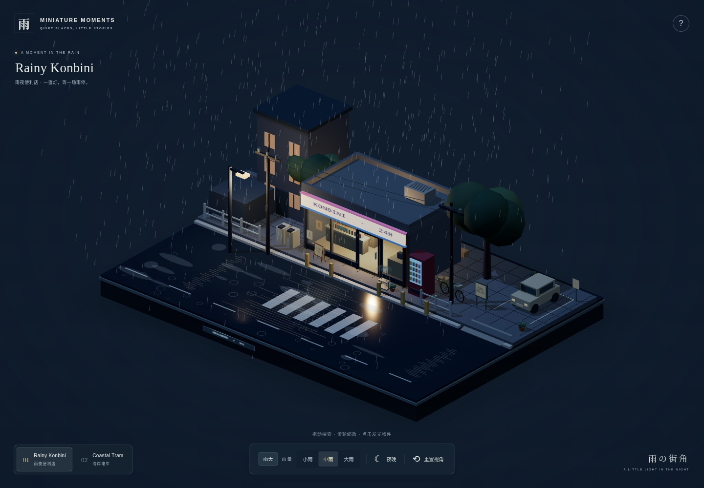
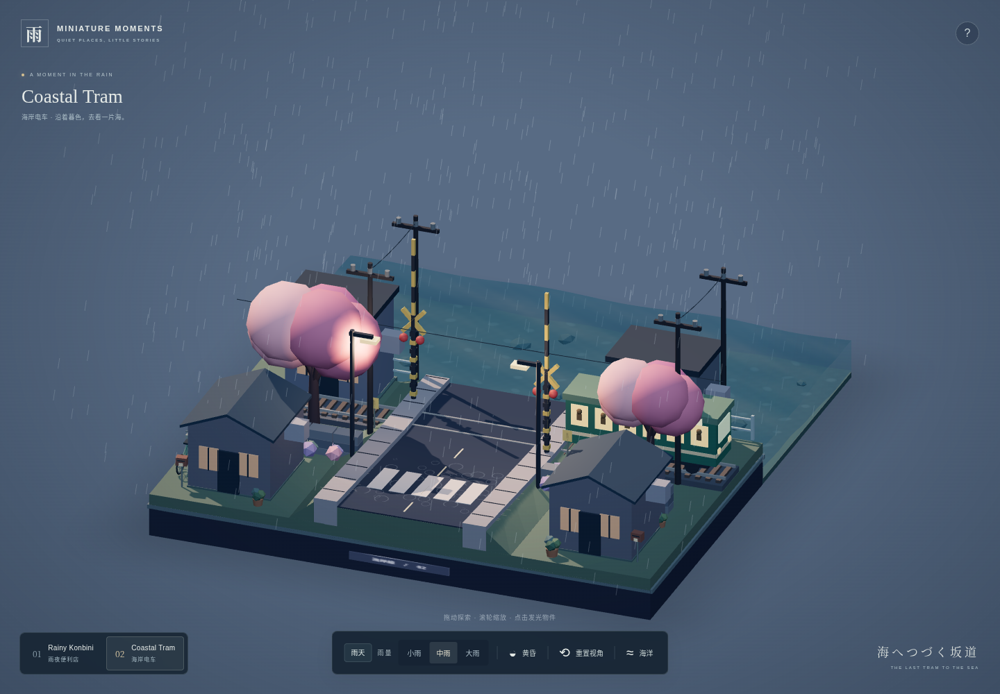
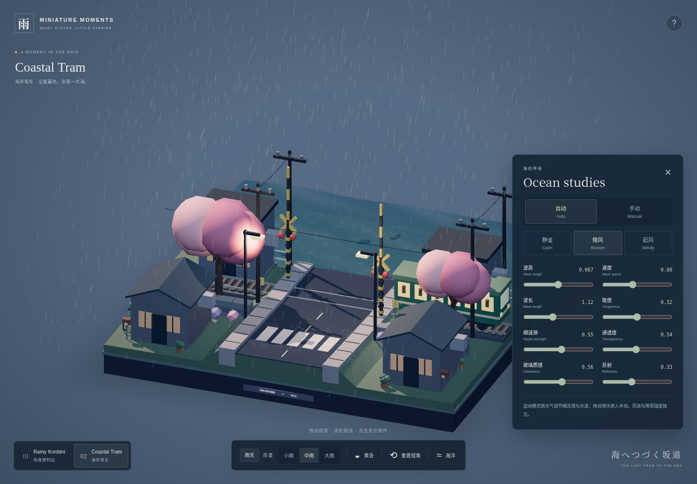
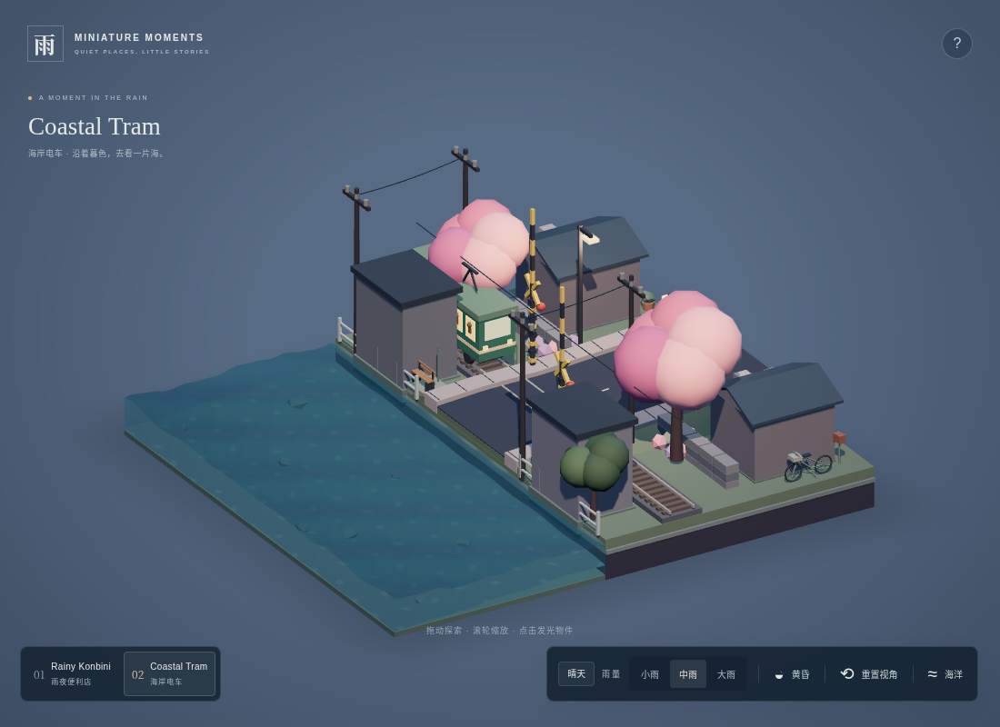
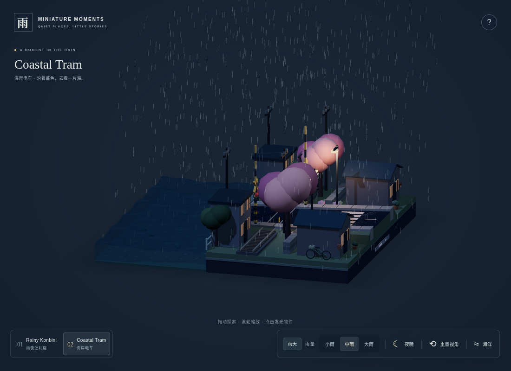

# Miniature Moments 4.0 交付报告

本轮在 `c06d7c63d654` 的现有项目上增量开发，保留两场景、交互、正交相机与修复过的几何结构。没有重新初始化项目，也没有新增运行时依赖。设计目标为 Quiet Living Diorama，聚焦生活细节、空间层次与可调动态海洋。

## 阶段交付与主要文件

| 阶段                 | 实际结果                                                                                     | 主要文件                                                                                                                               |
| -------------------- | -------------------------------------------------------------------------------------------- | -------------------------------------------------------------------------------------------------------------------------------------- |
| 1 审查、研究和规划   | 先检查渲染/生命周期及原有修复；核实参考项目与许可；确定有限扩建和 WebGL Gerstner 方案        | `DESIGN.md`、`docs/v4/RESEARCH.md`                                                                                                     |
| 2 场景扩建           | A 向侧面扩展，B 延伸海域；原建筑、开门范围、铁路与道口位置保持                               | `src/core/geometry.ts`、`src/scenes/SceneA.ts`、`src/scenes/SceneB.ts`                                                                 |
| 3 生活道具           | 两场景 P0 道具、适量停车/服务设施/长椅；静态不透明道具按材质合批                             | `src/props/LivingProps.ts`、`src/props/SceneDressing.ts`                                                                               |
| 4 海洋原型及正式集成 | Shader / Physical 原型均实际编译运行后选择 Shader；三组 Gerstner、八参数控制、预设和天气联动 | `src/lab/water-lab.ts`、`src/ocean/*`、`src/water/OceanWater.ts`、`src/ui/OceanPanel.ts`                                               |
| 5 氛围和 UI          | 冷暖侧光与补光、底座柔影、店前柔光、细微树动；天气选择和折叠海洋面板                         | `src/core/Environment.ts`、`SoftLight.ts`、`Renderer.ts`、`InteractionManager.ts`、`WeatherSystem.ts`、`src/ui/UI.ts`、`src/style.css` |
| 6 验收               | 几何/状态/波浪安全测试、实际 Chromium 交互与响应式回归、录像、生产构建                       | `tests/ocean.test.ts`、`props.test.ts`、`water.test.ts`、`tests/browser/v4.spec.ts`、`worlds.spec.ts`                                  |

`src/main.ts` 与 `SceneManager.ts` 连接共用 OceanController、天气、灯光、面板和场景生命周期。`CoastalWater.ts` 保留旧导出入口，实际实现委托 OceanWater，避免破坏既有调用。

## 布局与建模

**Rainy Konbini**：14×12 底座向东扩为 17.2×12，水平面积约 +22.9%。便利店继续居中作为暖光焦点；新增一处轻型汽车停车位、接街低坡入口、靠侧墙停放的自行车。门左侧是促销牌，右侧为双透明伞架、盆栽；固定窗上有贴纸和营业时间。侧面公告板和后墙电表/空调/排水管提供背面细节。新增道具避开门扇扫掠及原有白护栏、黄色立柱。

**Coastal Tram**：保留陆地、实体坡道、轨道、住宅和栏杆枢轴。海水深度 3.6→6.6，中心 z=-5.7，岸线仍为 z=-2.4；整个沙盘由 14×12 扩为 14×15，面积 +25%。住宅旁增加不对称盆栽、两只信箱、门牌及一辆自行车；海边小平台上设置长椅与指示牌，道口旁有警示标志。后排住宅补充实体承台，前排补小高度基脚，避免临海建筑底部缺乏支撑。

模型均由几何体程序生成。透明伞罩和海床岩石使用 InstancedMesh；不透明道具按材质合并，招牌使用本地小 Canvas 纹理。树木整体以约 0.008 弧度作不同频率的偏航，已修复枝干连接保持完整。遵循此前偏好，没有飘落花瓣、自动运镜或电影模式。

## 海洋实现

- 三组波的基础波长 3.6 / 2.15 / 1.2、权重 .57 / .29 / .14，各有方向和相速；Gerstner 同时产生水平和垂直位移。
- 水面 64×32 分段；靠岸 0.85 单位内平滑减弱波浪，水平外边界 0.38 单位内限制水平位移。水面与侧壁共享 GLSL/CPU 波场及边界采样，顶部接缝持续闭合。
- 参数采用指数阻尼渐变；时间相位逐帧积分，调速不会重算绝对时间而跳相位。极值组合通过 CPU 采样检查水平映射雅可比、岸线与最低水位。
- 表面、外侧壁、海床分别建模。保留深度测试，透明面不写深度，侧壁仅绘制外侧；继续移除与陆地共面的岸侧透明墙。
- 使用正交相机正确视线计算 Fresnel、近似 Beer–Lambert 吸收、浅深水色、小幅法线波纹和弱岸沫。可见海床有 8 块贴地不规则岩石与低强度程序化焦散。
- 光泽来自天空色和方向高光近似；没有真实建筑倒影、物理折射、SSR 或 FFT，也没有额外反射渲染目标。

### 控件与范围

仅 Coastal Tram 显示“海洋”按钮，默认折叠。面板提供原生 range 滑块、键盘操作、数值、Auto/Manual、三个预设；Escape 可收起。范围钳制并拒绝 NaN/Infinity。

| 参数            | 范围     | 作用                             |
| --------------- | -------- | -------------------------------- |
| Wave Height     | .015–.12 | 三组波合计最大振幅，保持微缩比例 |
| Wave Speed      | .2–1.6   | 相位推进倍率                     |
| Wave Length     | .65–1.8  | 基础波长倍率                     |
| Choppiness      | 0–.65    | 水平位移 / 波峰陡度              |
| Ripple Strength | 0–1      | 细涟漪法线扰动                   |
| Transparency    | .25–.85  | 表面和侧面通透与吸收近似         |
| Glassiness      | 0–1      | 高光宽度与集中程度               |
| Reflection      | 0–.8     | Fresnel 天空色与高光权重         |

| 预设           | 波高 | 速度 | 波长倍率 | 陡度 | 基础通透度 |
| -------------- | ---- | ---- | -------- | ---- | ---------- |
| Calm           | .027 | .42  | 1.35     | .12  | .72        |
| Breeze（默认） | .067 | .80  | 1.12     | .32  | .58        |
| Windy          | .105 | 1.20 | .90      | .56  | .46        |

**Auto**：风浪来自所选预设。晴天降低细涟漪、提高少量通透；阴天降低反射；雨天依雨量增加细涟漪、稍降通透和反射。降雨不改变波高/风速预设，夜晚只改变水色和高光色。

**Manual**：拖动任意滑块自动进入手动；天气/雨量/昼夜不会覆盖手动参数。点击预设会提供新的八参数起点，仍可继续手调；返回 Auto 平滑恢复天气联动。参数在本次页面会话的场景切换中保留，未增加跨刷新保存。

## 视觉证据

以下均为实际 Chromium WebGL 截图，不是生成的效果图。

手机：[便利店](konbini-phone.png)、[海岸](coast-phone.png)、[海洋面板](panel-phone.png)。

iPad 尺寸触屏模拟：[横屏](coast-ipad-landscape.png)、[竖屏](coast-ipad-portrait.png)、[竖屏控件](panel-ipad-portrait.png)。这些不是实际 iPad / Safari 硬件截图。

[动态海洋录像](ocean-motion.webm)：最大波高/陡度、最短波长、快慢旋转、拉近拉远、晴/阴/雨及夜晚切换。可见波浪和侧壁连续运动；在测试视角内未观察到明显闪烁或裂缝。录像帧率由软件渲染环境限制，不作为真实设备流畅度证明。

## 性能与生命周期

同一 Chromium、1440×1000、DPR=1、中雨、默认初始视角，对比原提交 `c06d7c63d654` 与 4.0。使用 `renderer.info` 记录主渲染统计；这是渲染规模对比，不是 GPU 帧率基准。原始记录见 [performance.json](performance.json)。

| 场景    | 原 Draw calls → 4.0 | 增幅   | 三角形 原 → 4.0 | 几何资源 原 → 4.0 | 纹理 原 → 4.0 |
| ------- | ------------------- | ------ | --------------- | ----------------- | ------------- |
| Konbini | 160 → 194           | +21.3% | 10,520 → 13,010 | 153 → 186         | 3 → 9         |
| Coast   | 235 → 259           | +10.2% | 15,328 → 17,960 | 232 → 256         | 3 → 10        |

两场景绘制增量低于设计预算约 30%。没有新增全屏后期渲染或实时镜面反射通道。沿用桌面 DPR≤1.75、粗指针≤1.35、慢帧降级至 1，主光阴影 2048/1024 上限；其他灯光不新增阴影。

资源测试等新场景实际渲染后才读数，再确认帧数继续增长，避免将“旧场景刚释放”的瞬间误判为健康回收。连续五轮 A/B 切换后，海岸资源应与切换前一致（256 几何 / 10 纹理），并检查没有 WebGL context lost。新增控件只创建一次，场景切换不重复绑定其事件；场景销毁沿用 geometry/material/texture/实例缓冲的去重释放。

## 验证和部署

- `npm test`：21 项通过，包含门/栏杆扫掠、原有树枝/护栏/屋顶/实体坡道、新道具接地、波浪边界/极值/预设渐变及天气隔离。
- `npm run build`：通过 TypeScript 与 Vite；Three.js 独立包约 528.4 kB / gzip 135.2 kB，保留 Vite 的大包提示，没有隐藏警告。
- `npm run test:browser`：完整 10 项通过（约 5.3 分钟），包含既有两轮回归、实体 Raycaster 点击、门/车灯/小猫、道口完整运行及连续点击锁定、触摸旋转/缩放、五种屏幕尺寸取景、原型、海洋八参数与极值、天气隔离、场景切换持久性、减少动态效果。浏览器没有新增控制台或 Shader 错误，日志见 [browser-tests.txt](browser-tests.txt)。
- 五轮 A/B 切换：实际渲染后的海岸资源从 256 几何 / 10 纹理回到 256 / 10，Draw calls 259；帧继续推进，WebGL 上下文未丢失。
- 单独启用 `RECORD_OCEAN_VIDEO=1` 的动态海洋用例通过，交付约 29 秒 WebM，压缩为约 1.7 MB。
- `npm run preview -- --port 4173`：实际浏览器加载生产 `dist`，检查桌面/手机的两场景、八参数面板、Calm 渐变和两种原型的昼夜响应，均通过，没有运行时或 Shader 错误。[生产检查记录](production-smoke.json)。最终桌面/手机主图和控件截图取自该生产预览。
- 发布继续使用原 `.github/workflows/pages.yml`，推送 `main` 后执行 `npm ci → npm test → npm run build → Pages`；未另建部署系统。[工作流状态](https://github.com/JiyannLi/miniature-moments/actions/workflows/pages.yml) · [公开预览入口](https://jiyannli.github.io/miniature-moments/)。本环境访问 `github.io` 受代理限制，无法直接检查线上页面视觉；本地生产包已验证，线上发布结果以对应提交的 GitHub Actions 状态为准。

## 限制与取舍

没有实际 iPad 或 Safari 硬件可用，完成 Chromium 横竖屏触屏模拟和手机单指/双指操作验证；仍需要真实设备补验性能与透明混合表现。当前软件 WebGL 的 FPS 不代表用户设备。

灯光反射、水深吸收和焦散是低成本视觉近似。没有引入第三方海洋引擎或未授权资产。未增加额外住宅、复杂附属建筑或大量草丛，以保留海面、列车和便利店的视觉中心。所有参考许可及未可访问项目详见 [RESEARCH.md](RESEARCH.md)。
