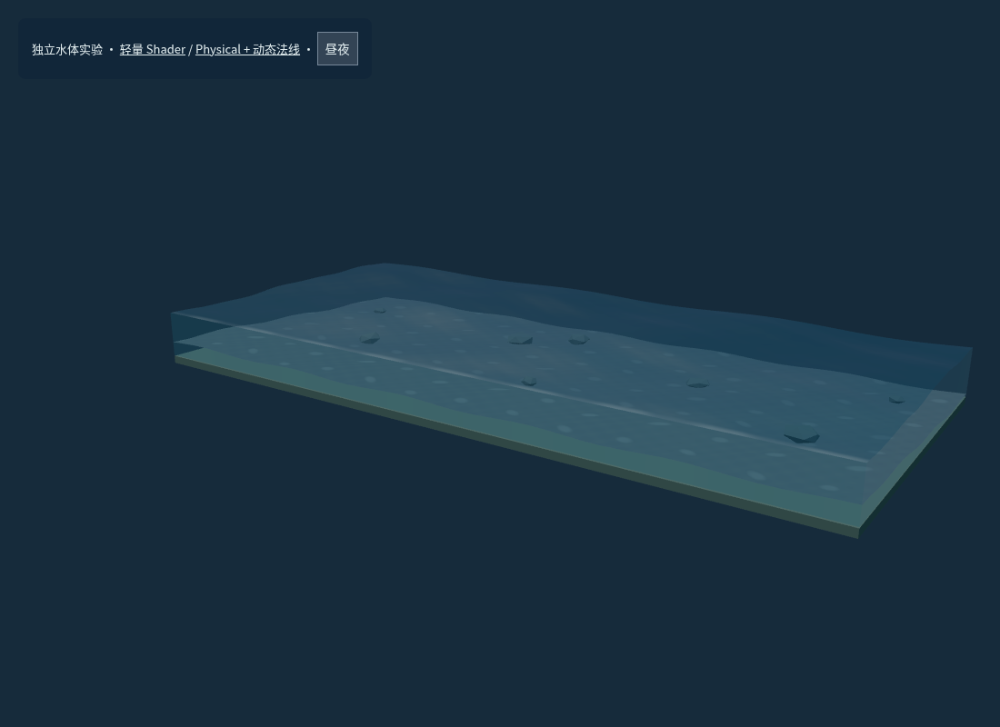
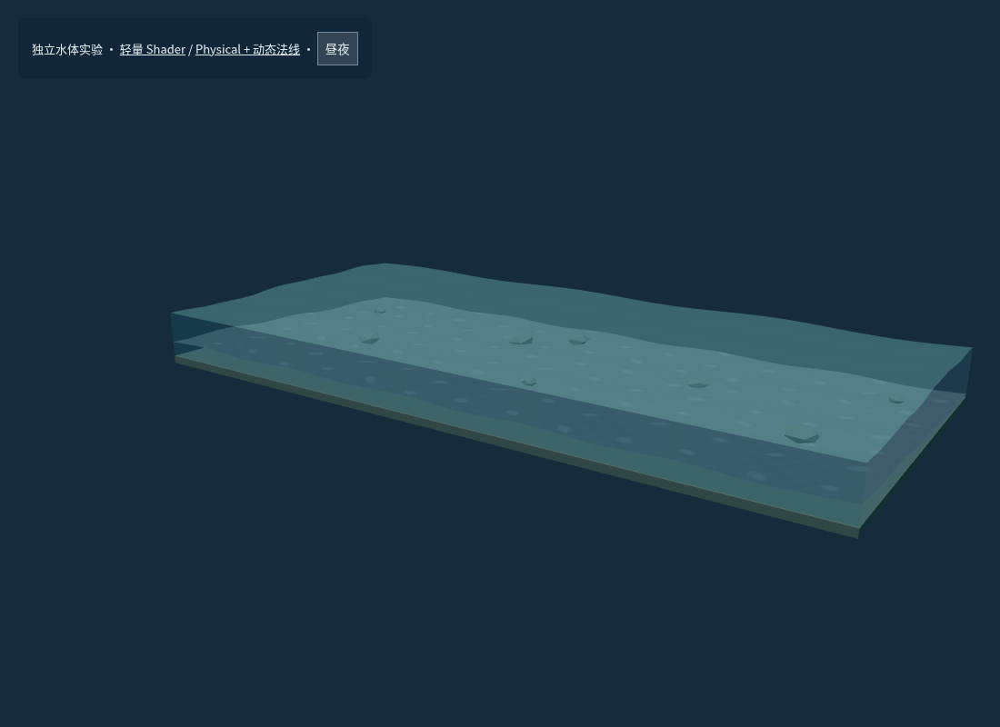

# 4.0 参考核查与技术取舍

核查日期：2026-10-28。通过 GitHub 只读克隆检查 README、相关源文件和许可证；未安装这些仓库的依赖，也未导入其代码、美术或技能指令。下列版本号为核查时的提交。

| 参考                                                                                     | 实际访问 / 许可证                                                                                | 本项目采用的思路                                                                   |
| ---------------------------------------------------------------------------------------- | ------------------------------------------------------------------------------------------------ | ---------------------------------------------------------------------------------- |
| [AI Design Skills](https://github.com/elayadesign/ai-design-skills)                      | 可访问，`ded7efc9d5c0`，根目录 MIT                                                               | 明确视觉中心、限制装饰密度、统一色彩与文字层级                                     |
| [Frontend Design](https://github.com/anthropics/skills/tree/main/skills/frontend-design) | 可访问，`dbd4588f9e10`，该技能目录 LICENSE.txt 为 Apache-2.0                                     | 将字体、留白和控件作为整体；不套用商业首页模板                                     |
| [Emil Kowalski Skills](https://github.com/emilkowalski/skills)                           | 可访问，`2d228630ba14`，MIT                                                                      | 控件反馈短于面板过渡；支持键盘和减少动态效果                                       |
| [UI Skills](https://github.com/ibelick/ui-skills)                                        | 可访问，`59193a75432e`，MIT                                                                      | 原生可访问表单、明确选择状态、紧凑且有边界的控制面板                               |
| [sakura-city](https://github.com/Isk5434/sakura-city)                                    | 可访问，`e7562c27ee0f`；未找到根目录许可证或 README 授权声明                                     | 只观察街区层次、日式街景密度；不复制模型或代码                                     |
| [sakuragaoka-station](https://github.com/Kenton-GMI/sakuragaoka-station)                 | 可访问，`4112f57208b7`，MIT                                                                      | 程序化住宅、铁路周边设施与克制的生活道具；保留本项目模型                           |
| [Three.js 官方示例与文档](https://threejs.org/examples/?q=water)                         | 本环境官网直连受限；已检查本地安装的 r180 `examples/jsm/objects/Water.js` 及 Three.js MIT 许可证 | 平面反射需要额外场景渲染；本轮选择低成本天空色/Fresnel 近似                        |
| [threejs-water-free](https://github.com/baditaflorin/threejs-water-free)                 | 可访问，`4a2dd82ed439`，MIT                                                                      | 有限海况预设和质量预算；其 WebGPU / TSL、FFT 与 JONSWAP 不适合现有 WebGL r180 集成 |
| [WaterThreeJS](https://github.com/achrefelouafi/WaterThreeJS)                            | 可访问，`4f85f4a557da`，MIT                                                                      | 分离风浪、表面光泽与水下表现；未移植其较新版 Three.js、SSR 或体积渲染流程          |
| [momokula123/threejs-water](https://github.com/momokula123/threejs-water)                | 可访问，`46fe7366c8c2`；README 声明 MIT，但未见根目录 LICENSE                                    | 只参考分层水体与参数组织；不将声明视为全部资产的明确许可，不复制资源               |
| [Cinematic Ocean](https://github.com/nguyencongnamit/threejs-ocean)                      | Git 访问返回 repository not found，无法核实存在性或许可证                                        | 跳过，未阻塞开发                                                                   |

## 与现有架构的匹配

本项目保留 Three.js r180 的 WebGLRenderer、单次主场景渲染和现有正交相机。没有引入海洋引擎、后期处理依赖或外部纹理。所有新模型、招牌和 Shader 均在现有辅助函数基础上独立编写。

采用三组多方向 Gerstner 波，对海面与侧壁共享水平/垂直位移；通过 Shore 衰减、边缘限制和参数上限约束几何。片元加入小幅法线扰动、Fresnel、近似 Beer–Lambert 吸收和克制岸沫。天空反射是艺术化近似，不是建筑实时倒影。这样可以保留透明剖面、可见海床和原有深度测试，又无需 FFT、额外反射目标或多层折射。

在 `water-lab.html?mode=shader` 和 `?mode=physical` 对照自定义 Shader 与 MeshPhysicalMaterial：两者都使用相同 Gerstner 位移。实际 Chromium 编译和昼夜切换均通过；选择自定义 Shader 作为正式方案，便于一致控制侧壁、吸收与法线，并避免依赖 transmission 的额外渲染。

## 视觉方案

沿用既有沉浸式页面和 Miniature Moments 品牌，细调字距、背景、按钮状态和边缘控件。海洋面板默认折叠，280ms 显隐；滑块提供标签、键盘输入与数值。场景仍由用户旋转观察。树木只作极小、不同频率的偏航，不做缩放呼吸，也不增加此前用户取消的飘落花瓣。

布局和性能预算在开发前记录于 [DESIGN.md](../../DESIGN.md)。运行时依赖仍只有 Three.js；现有依赖许可证记录见 [REFERENCES.md](../REFERENCES.md)。
